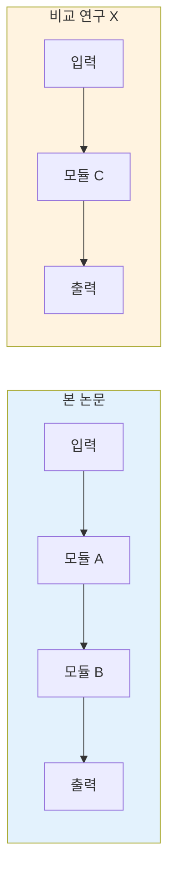

# Comparison Matrix Guide (관련 연구 비교 매트릭스 가이드)

본 논문과 핵심 관련 연구 3-5편을 체계적으로 비교하기 위한 가이드입니다.

---

## 목적

- 본 논문의 **고유 기여**를 한눈에 파악
- 관련 연구 간 **방법론적 차이**를 구조화
- **연구 갭**과 **발전 방향** 시각화

---

## 기본 비교 매트릭스 템플릿

```markdown
### 관련 연구 비교 매트릭스

| 축 | 본 논문 | {비교 1} | {비교 2} | {비교 3} |
|----|---------|----------|----------|----------|
| **핵심 접근** | {방법} | {방법} | {방법} | {방법} |
| **문제 정의** | {범위} | {범위} | {범위} | {범위} |
| **데이터** | {종류/규모} | {종류/규모} | {종류/규모} | {종류/규모} |
| **핵심 메트릭** | {결과} | {결과} | {결과} | {결과} |
| **확장성** | {평가} | {평가} | {평가} | {평가} |
| **한계** | {한계} | {한계} | {한계} | {한계} |
| **코드 공개** | ✅/❌ | ✅/❌ | ✅/❌ | ✅/❌ |
```

---

## 분야별 비교 축 가이드

### NLP / LLM 연구

| 비교 축 | 설명 |
|---------|------|
| 모델 아키텍처 | Encoder-only / Decoder-only / Encoder-Decoder |
| 학습 방법 | Pretraining / Fine-tuning / In-context / RLHF |
| 모델 크기 | 파라미터 수 (7B, 13B, 70B 등) |
| 평가 벤치마크 | MMLU, HumanEval, MT-Bench 등 |
| 추론 전략 | CoT, ToT, ReAct 등 |
| 컨텍스트 길이 | 지원 토큰 수 |

### Computer Vision 연구

| 비교 축 | 설명 |
|---------|------|
| 백본 | ViT / CNN / Hybrid |
| 사전학습 | ImageNet / CLIP / DINOv2 |
| 해상도 | 입력 이미지 크기 |
| 데이터 규모 | 학습 데이터 크기 |
| 주요 메트릭 | AP, mIoU, FID 등 |
| 연산 효율 | FLOPs, 추론 속도 |

### 일반 ML 연구

| 비교 축 | 설명 |
|---------|------|
| 학습 패러다임 | Supervised / Self-supervised / Semi-supervised / RL |
| 이론적 기반 | 수학적 프레임워크 |
| 가정 조건 | 필요한 전제 조건 |
| 일반화 능력 | OOD 성능, 도메인 전이 |
| 계산 복잡도 | 시간/공간 복잡도 |

---

## 비교 선정 기준

비교 대상 논문은 다음 기준으로 3-5편 선정:

1. **직접 비교 대상**: 동일 문제를 다른 방법으로 해결한 논문 (1-2편)
2. **기반 연구**: 본 논문이 확장/개선한 원 논문 (1편)
3. **최신 SOTA**: 가장 최근의 최고 성능 논문 (1편)
4. **대안적 접근**: 근본적으로 다른 패러다임의 논문 (0-1편)

---

## 매트릭스 작성 규칙

1. **정량적 비교 우선**: 가능한 한 구체적 수치 포함
2. **공정한 비교**: 동일 벤치마크/설정에서의 결과만 직접 비교
3. **맥락 포함**: 단순 수치 비교가 아닌, 왜 차이가 나는지 1줄 설명
4. **빈 셀 허용**: 해당 정보가 없으면 "N/A" 또는 "미보고"로 표기
5. **강점/약점 균형**: 본 논문의 우위만이 아닌, 열위인 부분도 솔직하게 기록

---

## Mermaid 비교 다이어그램 (선택)

방법론의 구조적 차이를 시각화할 때 사용:


