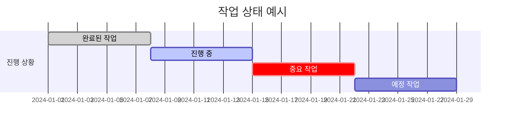

# Gantt Schedule Guide (Mermaid Gantt 차트 가이드)

연구 일정을 Mermaid Gantt 차트로 시각화하기 위한 가이드입니다.

---

## 1. 기본 문법

### 최소 구조

```mermaid
gantt
    title 연구 일정
    dateFormat YYYY-MM-DD
    section 섹션명
        작업명 :태스크ID, 시작일, 기간
```

### 주요 속성

| 속성 | 문법 | 예시 |
|------|------|------|
| 제목 | `title {텍스트}` | `title 연구 일정` |
| 날짜 형식 | `dateFormat {형식}` | `dateFormat YYYY-MM-DD` |
| 축 형식 | `axisFormat {형식}` | `axisFormat %Y-%m` |
| 마일스톤 | `milestone` 키워드 | `데드라인 :milestone, m1, 2024-06-01, 0d` |
| 의존성 | `after {태스크ID}` | `분석 :after data_collect, 14d` |
| 상태 | `done`, `active`, `crit` | `완료 작업 :done, a1, 2024-01-01, 7d` |

### 기간 표기

| 표기 | 의미 | 예시 |
|------|------|------|
| `Nd` | N일 | `14d` = 2주 |
| `after {id}` | 이전 작업 후 시작 | `after a1` |
| 절대 날짜 | 특정 날짜 시작 | `2024-01-15` |

---

## 2. 연구 일정 Gantt 템플릿

### 기본 연구 템플릿

```mermaid
gantt
    title 연구 프로젝트 일정
    dateFormat YYYY-MM-DD
    axisFormat %Y-%m

    section 1. 준비
        문헌 조사          :lit, {시작일}, 14d
        연구 설계          :design, after lit, 7d
        데이터 수집 계획    :plan, after design, 5d

    section 2. 데이터
        데이터 수집/구축    :data, after plan, 21d
        전처리 및 검증      :preproc, after data, 7d

    section 3. 실험
        파일럿 실험         :pilot, after preproc, 7d
        본 실험 (1차)      :exp1, after pilot, 14d
        결과 분석 (중간)    :mid_anal, after exp1, 5d
        본 실험 (2차)      :exp2, after mid_anal, 14d

    section 4. 분석 및 작성
        최종 결과 분석      :analysis, after exp2, 14d
        논문 초고 작성      :draft, after analysis, 21d
        내부 리뷰           :review, after draft, 7d
        수정 및 투고        :submit, after review, 14d

    section 마일스톤
        중간 발표           :milestone, m1, after mid_anal, 0d
        논문 투고           :milestone, m2, after submit, 0d
```

### 병렬 작업 포함 템플릿

```mermaid
gantt
    title 연구 일정 (병렬 작업 포함)
    dateFormat YYYY-MM-DD

    section 준비
        문헌 조사           :lit, {시작일}, 14d
        환경 세팅           :env, {시작일}, 7d
        데이터 수집         :data, after lit, 21d
        베이스라인 구현      :baseline, after env, 14d

    section 제안 방법
        방법 설계           :method, after baseline, 7d
        구현                :impl, after method, 14d
        디버깅/최적화       :debug, after impl, 7d

    section 실험
        실험 1 (소규모)     :exp_small, after debug, 7d
        실험 2 (대규모)     :exp_large, after exp_small, 14d
        Ablation Study     :ablation, after exp_small, 14d
        분석 및 시각화      :viz, after exp_large, 7d

    section 논문
        Related Work 작성   :rw, after lit, 21d
        Method 섹션 작성    :method_sec, after impl, 7d
        Experiment 작성     :exp_sec, after viz, 14d
        논문 통합 및 수정   :paper, after exp_sec, 14d
```

---

## 3. 스타일링 옵션

### 상태 표시

```
완료된 작업    :done, id, 시작, 기간
진행 중 작업   :active, id, 시작, 기간
크리티컬 작업  :crit, id, 시작, 기간
크리티컬+활성  :crit, active, id, 시작, 기간
```

### 예시



---

## 4. 작성 규칙

### 필수 규칙
1. **날짜 형식**: 항상 `YYYY-MM-DD` 사용
2. **축 형식**: `axisFormat %Y-%m` (월 단위가 연구 일정에 적합)
3. **섹션 분리**: 연구 단계별로 section 구분 (준비/실험/분석/작성)
4. **의존성**: `after {id}`로 작업 순서 명시
5. **마일스톤**: 핵심 데드라인은 반드시 milestone으로 표시

### 추천 규칙
1. **작업 ID**: 영문 소문자+숫자로 짧게 (예: `lit`, `exp1`, `draft`)
2. **기간 단위**: 일(d) 단위. 7d = 1주, 14d = 2주
3. **여유 시간**: 각 단계에 20-30% 버퍼 포함 권장
4. **병렬 작업**: 독립적 작업은 같은 시작점에서 병렬로 배치
5. **크리티컬 패스**: 전체 일정을 결정하는 핵심 작업에 `crit` 표시

### 주의사항
- Mermaid Gantt에서 한글 작업명 사용 가능 (따옴표 불필요)
- 태스크 ID에 하이픈(`-`) 사용 불가, 언더스코어(`_`) 사용
- `after` 키워드 뒤에는 정확한 태스크 ID 필요
- 마일스톤 기간은 반드시 `0d`

---

## 5. 일정 추정 팁

### 경험적 규칙 (Heuristic)

1. **1.5x 규칙**: 처음 추정한 시간의 1.5배가 현실적
2. **Hofstadter 법칙**: 예상보다 항상 더 오래 걸림, 이를 감안해도 마찬가지
3. **병렬화 한계**: 동시에 3개 이상의 작업을 효과적으로 진행하기 어려움
4. **리뷰 시간**: 논문 리뷰/수정은 항상 예상의 2배 이상
5. **환경 설정**: "금방 끝난다"고 생각하는 설정 작업에 최소 1주 할당

### 단계별 의존성 매트릭스

```
문헌 조사 → 연구 설계 → 데이터 계획
                ↓
         환경 세팅 (병렬 가능)
                ↓
         데이터 수집 → 전처리 → 파일럿 → 본 실험
                                          ↓
                                    결과 분석 → 논문 작성
```
