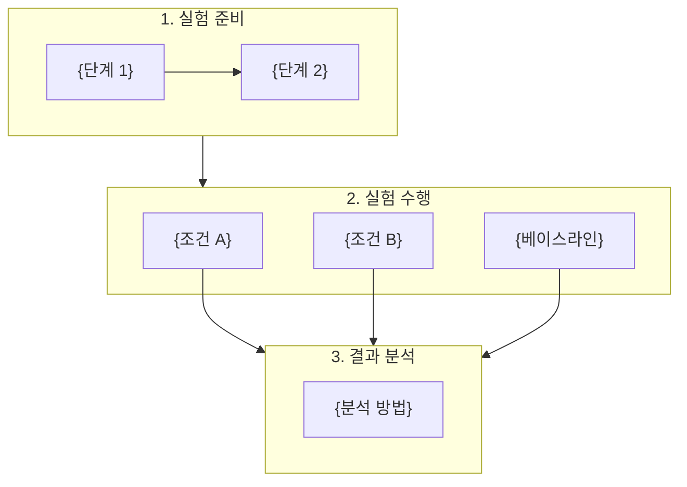

# Research Proposal Template (연구 계획서 템플릿)

최종 연구 계획서의 정확한 구조와 형식입니다. 16개 섹션으로 구성됩니다.

---

## YAML Frontmatter

```yaml
---
연구 제목: "{연구 제목}"
연구자: "{사용자명 또는 미지정}"
작성일: "{YYYY-MM-DD}"
연구 분야: "{분야}"
키워드: ["{keyword1}", "{keyword2}", "{keyword3}"]
비평 점수: "{최종 점수}/25"
비평 라운드: {N}
상태: "{통과/조건부 통과/경고 포함 진행}"
target_audience: "{NSF/NIH/General/Thesis}"
preliminary_data: "{경로 또는 N/A}"
broader_impacts: "{포함/해당없음}"
ethical_review: "{필요/해당없음}"
---
```

---

## 문서 구조

```markdown
# {연구 제목}

> **연구 분야**: {분야}
> **키워드**: {keyword1}, {keyword2}, {keyword3}
> **작성일**: {YYYY-MM-DD}
> **비평 점수**: {점수}/25 (라운드 {N})

---

## 0. 초록 (Abstract)

> [!abstract] 초록
> {연구 전체를 250단어 이내로 요약. 문제, 접근법, 방법론, 예상 기여를 포함}
>
> **키워드**: {keyword1}, {keyword2}, {keyword3}, {keyword4}, {keyword5}

> [!warning] Pitfall: 초록은 계획서의 마지막에 작성하되, 독자가 가장 먼저 읽는 부분임. 연구의 핵심 가치를 명확히 전달해야 함.

---

## 1. 연구 개요 (Executive Summary)

> [!summary] 연구 개요
> {연구의 핵심을 3-5문장으로 요약. 문제, 접근법, 예상 기여를 포함}

- **연구 동기**: {왜 이 연구가 필요한가}
- **핵심 아이디어**: {1-2문장으로 핵심 접근법}
- **예상 기여**: {주요 기여 1-3가지}
- **주요 연구 질문**: {핵심 RQ 1-2개}

> [!warning] Pitfall: 범위가 너무 넓으면 실행 불가능. "무엇을, 어떤 조건에서, 어떻게 측정하는가"가 명확해야 함.

---

## 2. 연구 배경 (Background)

### 2.1 문제 정의

{연구가 해결하고자 하는 문제를 명확하게 정의. 현재 상황, 문제점, 해결의 필요성}

### 2.2 핵심 개념

{연구에서 사용하는 핵심 개념/이론/프레임워크 설명}

### 2.3 기존 접근법의 한계

{현재까지의 접근법들이 가진 한계점. 이 연구가 극복하고자 하는 부분}

---

## 3. 선행 연구 분석 (Prior Research)

### 3.1 핵심 선행 연구

| # | 논문 | 핵심 기여 | 본 연구와의 관계 |
|---|------|-----------|------------------|
| 1 | {논문 1} | {기여} | {관계: 기반/확장/대립/보완} |
| 2 | {논문 2} | {기여} | {관계} |
| ... | ... | ... | ... |

### 3.2 연구 갭 분석

{선행 연구들을 종합했을 때 드러나는 연구 갭. 본 연구가 이 갭을 어떻게 메우는지}

### 3.3 본 연구의 차별점

{선행 연구 대비 본 연구만의 고유한 기여와 접근법의 차이}

> [!warning] Pitfall: 선행 연구를 나열만 하면 안 됨. 각 논문 간 관계와 본 연구와의 연결을 분석적으로 기술. Landmark 논문 3편 이상 필수 포함.

---

## 4. 연구 질문 및 가설 (Research Questions & Hypotheses)

### 4.1 연구 질문

| RQ | 질문 | 유형 |
|----|------|------|
| RQ1 | {질문} | {탐색적/확인적/비교} |
| RQ2 | {질문} | {유형} |

### 4.2 가설

| 가설 | 내용 | 대응 RQ | 검증 방법 |
|------|------|---------|-----------|
| H1 | {가설 서술} | RQ1 | {방법} |
| H2 | {가설 서술} | RQ1 | {방법} |
| H3 | {가설 서술} | RQ2 | {방법} |

### 4.3 핵심 가정 (Assumptions)

{이 연구가 성립하기 위해 필요한 전제 조건. 가설과 분리하여 명시}

| # | 가정 | 근거 | 위반 시 영향 |
|---|------|------|--------------|
| A1 | {가정} | {왜 합리적인지} | {가정이 틀리면 어떤 영향} |
| A2 | {가정} | {근거} | {영향} |

---

## 5. 학술적 기여 (Academic Contribution)

### 5.1 기여 유형 및 수준

| # | 기여 | 유형 | 수준 | 설명 |
|---|------|------|------|------|
| 1 | {기여 1} | {이론적/방법론적/실증적/응용적} | {혁신적/상당한/증분적} | {설명} |
| 2 | {기여 2} | {유형} | {수준} | {설명} |

### 5.2 기대 학술 영향

- **직접적 영향**: {이 연구 결과가 직접 영향을 미치는 영역}
- **간접적 영향**: {파생적으로 영향받을 수 있는 영역}
- **예상 대상 학회/저널**: {적합한 발표 venue}

### 5.3 한계 및 범위

{이 연구가 다루지 않는 범위, 알려진 한계점을 선제적으로 기술}

---

## 6. 실험 설계 (Experiment Design)

### 6.1 설계 개요

> [!important] 방법론 비중: 전체 계획서의 30-40%를 차지해야 함. 재현 가능할 수준의 구체성 필요.

- **설계 유형**: {Between-subjects / Within-subjects / Mixed / Quasi-experimental}
- **주요 비교**: {무엇과 무엇을 비교하는지}

### 6.2 변수 통제표

#### 독립 변수 (조작 변수)

| 변수명 | 설명 | 조작 수준 | 측정/조작 방법 |
|--------|------|-----------|----------------|
| {변수} | {설명} | {수준들} | {방법} |

#### 종속 변수 (결과 변수)

| 변수명 | 설명 | 측정 지표 | 측정 도구/방법 |
|--------|------|-----------|----------------|
| {변수} | {설명} | {지표} | {도구} |

#### 통제 변수 (고정 변수)

| 변수명 | 고정값 | 고정 이유 |
|--------|--------|-----------|
| {변수} | {값} | {이유} |

#### 외생 변수 (잠재적 혼동 변수)

| 변수명 | 잠재적 영향 | 완화 전략 |
|--------|-------------|-----------|
| {변수} | {영향} | {전략} |

### 6.3 실험 파이프라인



### 6.4 데이터 및 리소스

#### 데이터

| 항목 | 상세 | 확보 방법 |
|------|------|-----------|
| 학습 데이터 | {데이터셋, 크기} | {방법} |
| 평가 데이터 | {벤치마크, 크기} | {방법} |

#### 컴퓨팅 리소스

| 항목 | 사양/수량 | 근거 |
|------|-----------|------|
| GPU | {유형 × 수량} | {이유} |
| 학습 시간 | {N}시간 | {산출 근거} |
| 예상 비용 | ${X} | {산출 근거} |

---

## 7. 예비 결과 (Preliminary Results) — *preliminary_data 있을 때만 포함*

### 7.1 예비 실험 개요

{예비 실험의 목적, 설정, 규모}

### 7.2 예비 결과

{핵심 결과 — 테이블 또는 그래프 참조}

### 7.3 실현 가능성 증거

{예비 결과가 본 연구의 접근법이 작동할 수 있음을 보여주는 증거}

> [!warning] Pitfall: 예비 결과가 있는데 미포함하면 실현 가능성 입증 기회를 놓침. 반대로 예비 결과가 부정적이면 계획 수정 근거로 활용.

---

## 8. 실험 일정 (Schedule)

### 8.1 Gantt 차트

```mermaid
gantt
    title 연구 일정
    dateFormat YYYY-MM-DD
    axisFormat %Y-%m

    section 준비
        문헌 조사     :lit, {시작일}, 14d
        환경 구축     :env, {시작일}, 7d

    section 실험
        파일럿       :pilot, after env, 7d
        본 실험      :crit, exp, after pilot, 21d

    section 분석/작성
        결과 분석    :anal, after exp, 14d
        논문 작성    :paper, after anal, 28d

    section 마일스톤
        중간 점검    :milestone, m1, after pilot, 0d
        투고 목표    :milestone, m2, after paper, 0d
```

### 8.2 마일스톤

| # | 마일스톤 | 예상 날짜 | 성공 기준 |
|---|----------|-----------|-----------|
| M1 | {마일스톤 1} | {날짜} | {기준} |
| M2 | {마일스톤 2} | {날짜} | {기준} |

---

## 9. 예상 결과 및 분석 (Expected Results)

### 9.1 시나리오별 예상 결과

| 시나리오 | 조건 | 예상 결과 | 의미 | 후속 방향 |
|----------|------|-----------|------|-----------|
| Best Case | {H1, H2 모두 지지} | {결과} | {의미} | {방향} |
| Worst Case | {H1, H2 모두 기각} | {결과} | {의미} | {방향} |
| Mixed Case | {H1 지지, H2 기각} | {결과} | {의미} | {방향} |

### 9.2 분석 방법

{결과 분석에 사용할 통계 방법, 시각화 방법 등}

---

## 10. 사회적 영향 및 파급 효과 (Broader Impacts)

### 10.1 긍정적 영향

{이 연구가 사회/학계/산업에 미치는 긍정적 영향}

### 10.2 잠재적 부정적 영향

{악용 가능성, 편향 위험, 환경 영향 등}

### 10.3 영향 완화 전략

{부정적 영향을 최소화하기 위한 구체적 전략}

> [!warning] Pitfall: NSF/NIH 제안서에서 Broader Impacts 누락은 치명적. 기술적 기여만으로는 부족하며, 사회적 맥락을 반드시 기술.

---

## 11. 윤리적 고려사항 (Ethical Considerations)

### 11.1 데이터 윤리

{데이터 수집/사용의 윤리적 측면 — 개인정보, 동의, 편향}

### 11.2 IRB/윤리 위원회

{인간 대상 연구인 경우: IRB 승인 계획}
{해당 없는 경우: "본 연구는 인간 대상 데이터를 직접 수집하지 않으므로 IRB 승인이 불필요합니다."}

### 11.3 연구 진실성

{결과 보고의 투명성, 재현 가능성 보장 계획}

> [!warning] Pitfall: "해당 없음"으로 넘기지 말고, 왜 해당 없는지 명시적으로 기술해야 함.

---

## 12. 예산 정당화 (Budget Justification)

### 12.1 예산 요약

| 항목 | 금액 | 산출 근거 |
|------|------|-----------|
| 컴퓨팅 (GPU) | ${X} | {GPU 유형 × 시간 × 단가} |
| 데이터 | ${X} | {수집/구매/저장 비용} |
| 인건비 | ${X} | {인원 × 기간 × 단가} |
| 기타 | ${X} | {학회 참가비, 논문 출판비 등} |
| **총계** | **${X}** | |

### 12.2 각 항목 정당화

{각 예산 항목이 연구에 왜 필수적인지 설명}

> [!warning] Pitfall: 예산 없이 "무료 리소스 활용"만 기술하면 비현실적으로 보임. 비용이 0이더라도 어떤 리소스를 어떻게 확보하는지 명시.

---

## 13. 대비 계획 (Backup Plans)

### 13.1 위험 요소 및 대응

| # | 위험 요소 | 발생 확률 | 영향도 | Plan B | 전환 기준 |
|---|-----------|-----------|--------|--------|-----------|
| R1 | {위험} | 높음/중간/낮음 | 높음/중간/낮음 | {대비책} | {언제 전환하는지} |
| R2 | {위험} | {확률} | {영향} | {대비책} | {기준} |

### 13.2 Go/No-Go 기준

{각 단계에서 진행/중단/방향 전환을 결정하는 기준}

| 체크포인트 | 시점 | Go 기준 | No-Go 시 조치 |
|-----------|------|---------|---------------|
| {CP1} | {시점} | {기준} | {조치} |
| {CP2} | {시점} | {기준} | {조치} |

---

## 14. 비평 및 개선 이력 (Review History)

### 비평 라운드 요약

| 라운드 | 총점 | 논리 | 신규성 | 방법론 | 영향력 | 실현성 | 판정 |
|--------|------|------|--------|--------|--------|--------|------|
| 1 | ?/25 | ?/5 | ?/5 | ?/5 | ?/5 | ?/5 | {판정} |
| 2 | ?/25 | ?/5 | ?/5 | ?/5 | ?/5 | ?/5 | {판정} |

### 라운드 {N} 상세

**주요 비평 사항**:
1. {비평 1} → **수정**: {어떻게 수정했는지}
2. {비평 2} → **수정**: {어떻게 수정했는지}

**Reviewer 2 핵심 질문 및 대응**:
- Q: {질문} → A: {대응}

---

## 15. 참고 문헌 (References)

### 핵심 참고 문헌

1. {저자} ({연도}). {제목}. {출처}.
2. ...

### 방법론 참고 문헌

1. {저자} ({연도}). {제목}. {출처}.
2. ...
```

---

## 작성 지침

1. **언어**: 한국어로 작성, 영어 기술 용어는 원문 유지
2. **논문 제목**: 원어(영문) 유지
3. **Mermaid 다이어그램**: flowchart, gantt 차트 포함
4. **구체성**: 모든 수치(기간, 비용, 리소스)는 구체적으로 명시
5. **근거**: 주장에는 반드시 근거(선행 연구 또는 논리적 추론) 포함
6. **가정 분리**: 가설(Hypothesis)과 가정(Assumption)을 명확히 구분
